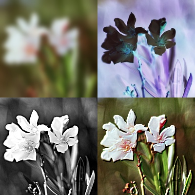
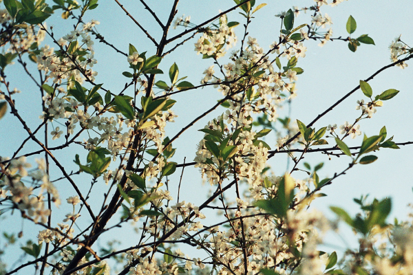
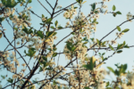
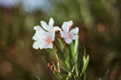
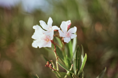
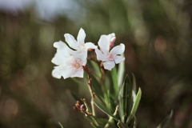
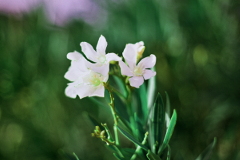

# Imaging

<!-- ALL-CONTRIBUTORS-BADGE:START - Do not remove or modify this section -->
[](#contributors-)
<!-- ALL-CONTRIBUTORS-BADGE:END -->
[](https://github.com/nao1215/imaging/actions/workflows/linux_test.yml)
[](https://github.com/nao1215/imaging/actions/workflows/mac_test.yml)
[](https://github.com/nao1215/imaging/actions/workflows/windows_test.yml)

[](https://github.com/nao1215/imaging/actions/workflows/gitleaks.yml)
[](https://github.com/nao1215/imaging/actions/workflows/trivy.yml)
[](https://github.com/nao1215/imaging/actions/workflows/govulncheck.yml)
[](https://github.com/nao1215/imaging/actions/workflows/gosec.yml)
[](https://github.com/nao1215/imaging/actions/workflows/reviewdog.yml)
[](https://pkg.go.dev/github.com/nao1215/imaging)
[](./LICENSE)
[](https://scorecard.dev/viewer/?uri=github.com/nao1215/imaging)

Imaging is a Go package for basic image processing: resizing, rotation, cropping, blurring, sharpening, and brightness, contrast, gamma, saturation and hue adjustments. It is a fork of [disintegration/imaging](https://github.com/disintegration/imaging), which is updated slowly; this fork adds bug fixes and tests on Linux, macOS and Windows.

Every image processing function accepts any `image.Image` and returns a new `*image.NRGBA` (32-bit RGBA, non-premultiplied alpha). The full API is documented at https://pkg.go.dev/github.com/nao1215/imaging.

## Supported platforms

Unit tests run on Linux, macOS and Windows with Go 1.26 or later.

## Example

```go
package main

import (
	"image"
	"image/color"
	"log"

	"github.com/nao1215/imaging"
)

func main() {
	// Open a test image.
	src, err := imaging.Open("testdata/flowers.png")
	if err != nil {
		log.Fatalf("failed to open image: %v", err)
	}

	// Crop the original image to 300x300px size using the center anchor.
	src = imaging.CropAnchor(src, 300, 300, imaging.Center)

	// Resize the cropped image to width = 200px preserving the aspect ratio.
	src = imaging.Resize(src, 200, 0, imaging.Lanczos)

	// Create a blurred version of the image.
	img1 := imaging.Blur(src, 5)

	// Create a grayscale version of the image with higher contrast and sharpness.
	img2 := imaging.Grayscale(src)
	img2 = imaging.AdjustContrast(img2, 20)
	img2 = imaging.Sharpen(img2, 2)

	// Create an inverted version of the image.
	img3 := imaging.Invert(src)

	// Create an embossed version of the image using a convolution filter.
	img4 := imaging.Convolve3x3(
		src,
		[9]float64{
			-1, -1, 0,
			-1, 1, 1,
			0, 1, 1,
		},
		nil,
	)

	// Create a new image and paste the four produced images into it.
	dst := imaging.New(400, 400, color.NRGBA{0, 0, 0, 0})
	dst = imaging.Paste(dst, img1, image.Pt(0, 0))
	dst = imaging.Paste(dst, img2, image.Pt(0, 200))
	dst = imaging.Paste(dst, img3, image.Pt(200, 0))
	dst = imaging.Paste(dst, img4, image.Pt(200, 200))

	// Save the resulting image as JPEG.
	err = imaging.Save(dst, "testdata/out_example.jpg")
	if err != nil {
		log.Fatalf("failed to save image: %v", err)
	}
}
```

Output:



## Resizing

```go
// Resize srcImage to size = 128x128px using the Lanczos filter.
dstImage128 := imaging.Resize(srcImage, 128, 128, imaging.Lanczos)

// Resize srcImage to width = 800px preserving the aspect ratio.
dstImage800 := imaging.Resize(srcImage, 800, 0, imaging.Lanczos)

// Scale down srcImage to fit the 800x600px bounding box.
dstImageFit := imaging.Fit(srcImage, 800, 600, imaging.Lanczos)

// Resize and crop the srcImage to fill the 100x100px area.
dstImageFill := imaging.Fill(srcImage, 100, 100, imaging.Center, imaging.Lanczos)
```

The most commonly used resampling filters:

- `Lanczos`: sharp results on photographs.
- `CatmullRom`: a sharp cubic filter, faster than Lanczos with similar results.
- `MitchellNetravali`: a cubic filter with smoother results and less ringing than CatmullRom.
- `Linear`: bilinear, smooth output, faster than the cubic filters.
- `Box`: a fast averaging filter for downscaling; when upscaling it is close to NearestNeighbor.
- `NearestNeighbor`: the fastest, with no antialiasing.

All supported filters: NearestNeighbor, Box, Linear, Hermite, MitchellNetravali, CatmullRom, BSpline, Gaussian, Lanczos, Hann, Hamming, Blackman, Bartlett, Welch, Cosine. You can define your own with the ResampleFilter struct.

The original 600x400px image:



Resized to 150x100px, from the fastest filter to the highest quality:

Filter                    | Resize result
--------------------------|---------------------------------------------
`imaging.NearestNeighbor` | 
`imaging.Linear`          | 
`imaging.CatmullRom`      | 
`imaging.Lanczos`         | 

## Blur and sharpen

```go
dstImage := imaging.Blur(srcImage, 0.5)
```

```go
dstImage := imaging.Sharpen(srcImage, 0.5)
```

Sigma sets the strength of both effects (`Sharpen` also uses a gaussian function).

Function | Original image | Sigma = 0.5 | Sigma = 1.5
---------|----------------|-------------|------------
`Blur` |  |  | 
`Sharpen` |  |  | 

## Color adjustments

```go
dstImage := imaging.AdjustGamma(srcImage, 0.75)
```

```go
dstImage := imaging.AdjustContrast(srcImage, 20)
```

```go
dstImage := imaging.AdjustBrightness(srcImage, 20)
```

```go
dstImage := imaging.AdjustSaturation(srcImage, 20)
```

```go
dstImage := imaging.AdjustHue(srcImage, 20)
```

Function | Original image | Result | Result
---------|----------------|--------|-------
`AdjustGamma` |  | Gamma = 0.75<br> | Gamma = 1.25<br>
`AdjustContrast` |  | Contrast = 15<br> | Contrast = -15<br>
`AdjustBrightness` |  | Brightness = 10<br> | Brightness = -10<br>
`AdjustSaturation` |  | Saturation = 30<br> | Saturation = -30<br>
`AdjustHue` |  | Hue = 60<br> | Hue = -60<br>

## FAQ

### The image is rotated after processing

The file probably has an EXIF orientation tag, which the standard `image/*` packages ignore. Open it with the `AutoOrientation` decode option, and the image is rotated according to the tag (if present) after decoding:

```go
img, err := imaging.Open("test.jpg", imaging.AutoOrientation(true))
```

## Testing

| Technique | Bug class caught here |
|---|---|
| Examples and unit tests ([example_test.go](example_test.go), [tools_test.go](tools_test.go)) | A function that no longer gives the pixels its tests spell out |
| Golden images ([resize_test.go](resize_test.go), [adjust_test.go](adjust_test.go), [effects_test.go](effects_test.go)) | A filter or adjustment whose output drifts from the reviewed image in `testdata/` |
| Metamorphic tests ([metamorphic_test.go](metamorphic_test.go)) | A result that changes with the image's origin or storage type, a flip or rotation that does not undo, or a resize that treats the two directions differently |
| Differential tests ([metamorphic_test.go](metamorphic_test.go), [scanner_test.go](scanner_test.go)) | A paste that disagrees with `image/draw`, or a fast path that reads another color than the image's own `At` |
| Fuzzing ([fuzz_test.go](fuzz_test.go)) | A crash or a wrong size on a malformed file, size, rectangle or angle |
| Mutation testing ([.github/workflows/mutation.yml](.github/workflows/mutation.yml)) | A test that runs a changed comparison or bound without noticing the change |

How to run each one is in [doc/testing.md](doc/testing.md).

## Contributors ✨

Thanks goes to these wonderful people ([emoji key](https://allcontributors.org/en/reference/emoji-key/)):

<!-- ALL-CONTRIBUTORS-LIST:START - Do not remove or modify this section -->
<!-- prettier-ignore-start -->
<!-- markdownlint-disable -->
<table>
  <tbody>
    <tr>
      <td align="center" valign="top" width="14.28%"><a href="https://debimate.jp/"><br /><sub><b>CHIKAMATSU Naohiro</b></sub></a><br /><a href="https://github.com/nao1215/imaging/commits?author=nao1215" title="Code">💻</a> <a href="https://github.com/nao1215/imaging/commits?author=nao1215" title="Documentation">📖</a></td>
      <td align="center" valign="top" width="14.28%"><a href="https://github.com/disintegration"><br /><sub><b>Grigory Dryapak</b></sub></a><br /><a href="https://github.com/nao1215/imaging/commits?author=disintegration" title="Code">💻</a></td>
    </tr>
  </tbody>
</table>

<!-- markdownlint-restore -->
<!-- prettier-ignore-end -->

<!-- ALL-CONTRIBUTORS-LIST:END -->

This project follows the [all-contributors](https://github.com/all-contributors/all-contributors) specification. Contributions of any kind welcome!

## Verifying releases

Each GitHub Release made from now on carries a source archive (`imaging-<tag>.tar.gz`), `checksums.txt`, a keyless cosign signature of it (`checksums.txt.sigstore.json`) and the build provenance of the archive (`imaging-<tag>.intoto.jsonl`). Download them from the release page (replace `<tag>` with the release tag), then verify:

```bash
gh attestation verify imaging-<tag>.tar.gz --repo nao1215/imaging \
  --bundle imaging-<tag>.intoto.jsonl

cosign verify-blob --bundle checksums.txt.sigstore.json \
  --certificate-identity-regexp '^https://github\.com/nao1215/imaging/\.github/workflows/release\.yml@refs/tags/v' \
  --certificate-oidc-issuer https://token.actions.githubusercontent.com \
  checksums.txt

sha256sum --check checksums.txt
```

## License

MIT License. See [LICENSE](LICENSE). Original author: [Disintegration](https://github.com/disintegration).
